# Assignments — Linux and DevOps Basics

## Assignment — Linux and SSH Setup

1. Launch an Amazon Linux 2023 EC2 instance in HYD region. Generate an SSH key pair. What is the difference between the two files created?
---
1a> Launch an Amazon Linux 2023 EC2 instance in HYD region.
Ans:
Before Launching EC2 instance, needs to do two things. One is to create security group and second one is to generate SSH keypai and Import Into AWS Console.
--security Group  'linuxpractice' created successfully and below is the details/evidence.
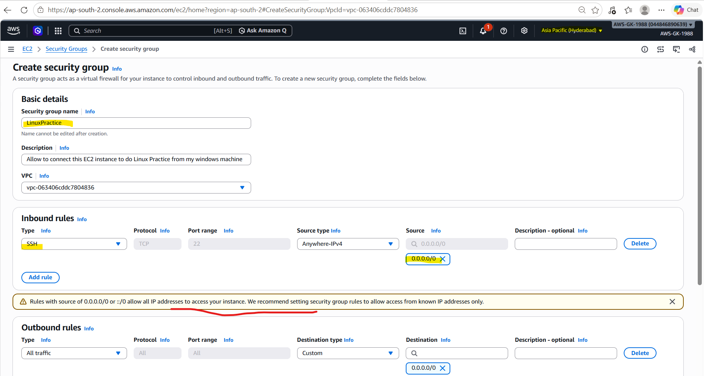
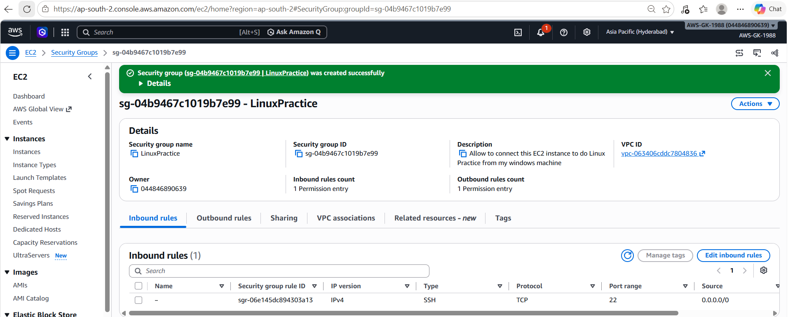

1b> Generate an SSH key pair.
---
Ans:
---Command (ssh-keygen -f <filename>)
$ ssh-keygen -f gkrishna
 -->>successfully created SSH Keypair and below is the evidence.
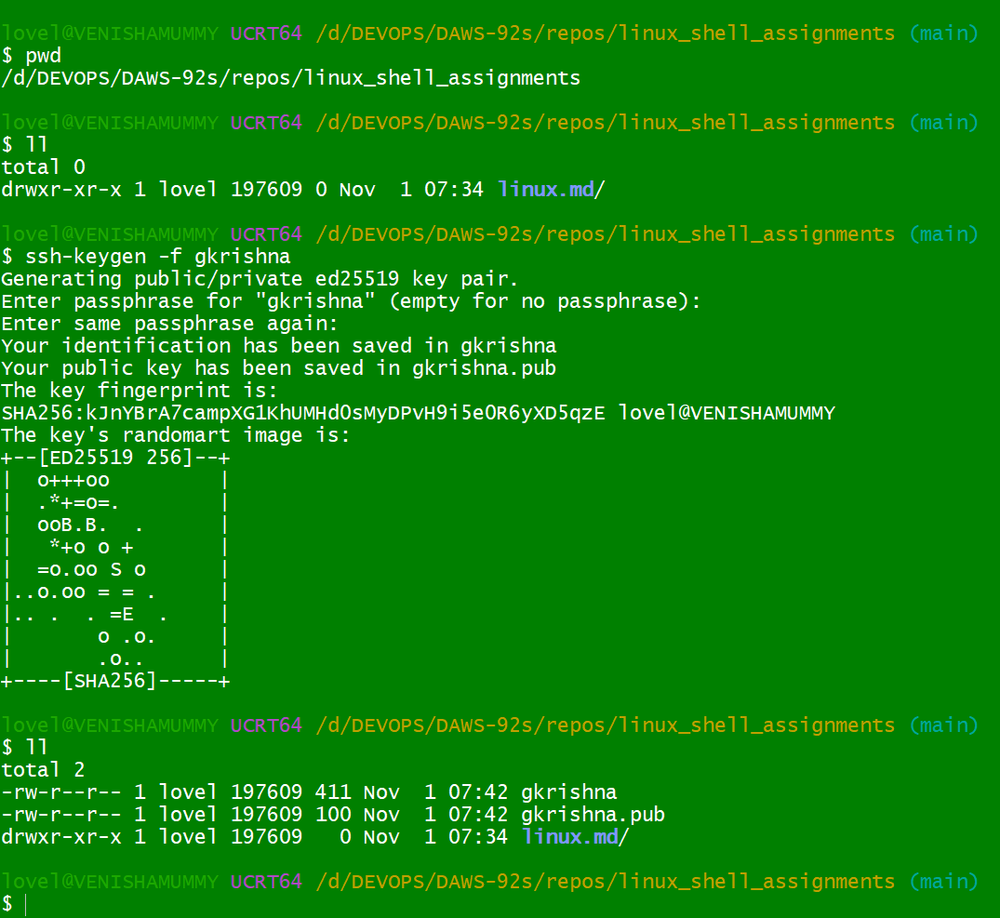
----------------------------------------------------------------------
lovel@VENISHAMUMMY UCRT64 /d/DEVOPS/DAWS-92s/repos/linux_shell_assignments (main)
$ pwd
/d/DEVOPS/DAWS-92s/repos/linux_shell_assignments
lovel@VENISHAMUMMY UCRT64 /d/DEVOPS/DAWS-92s/repos/linux_shell_assignments (main)
$ ll
total 0
drwxr-xr-x 1 lovel 197609 0 Nov  1 07:34 linux.md/
lovel@VENISHAMUMMY UCRT64 /d/DEVOPS/DAWS-92s/repos/linux_shell_assignments (main)
$ ssh-keygen -f gkrishna
Generating public/private ed25519 key pair.
Enter passphrase for "gkrishna" (empty for no passphrase):
Enter same passphrase again:
Your identification has been saved in gkrishna
Your public key has been saved in gkrishna.pub
The key fingerprint is:
SHA256:kJnYBrA7campXG1KhUMHd0sMyDPvH9i5e0R6yXD5qzE lovel@VENISHAMUMMY
The key's randomart image is:
+--[ED25519 256]--+
|  o+++oo         |
|  .*+=o=.        |
|  ooB.B.  .      |
|   *+o o +       |
|  =o.oo S o      |
|..o.oo = = .     |
|.. .  . =E  .    |
|       o .o.     |
|       .o..      |
+----[SHA256]-----+
lovel@VENISHAMUMMY UCRT64 /d/DEVOPS/DAWS-92s/repos/linux_shell_assignments (main)
$ ll
total 2
-rw-r--r-- 1 lovel 197609 411 Nov  1 07:42 gkrishna
-rw-r--r-- 1 lovel 197609 100 Nov  1 07:42 gkrishna.pub
drwxr-xr-x 1 lovel 197609   0 Nov  1 07:34 linux.md/
lovel@VENISHAMUMMY UCRT64 /d/DEVOPS/DAWS-92s/repos/linux_shell_assignments (main)
$
---------------------------------------------------
successfully launched the EC2 instance in HYD region and below is the evidence.
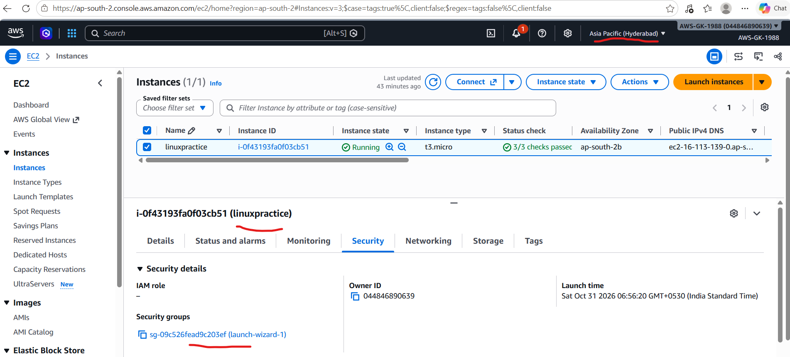
---------------------------------------------------
c> What is the difference between the two files created?
---
Ans:
Generated SSH keypair successfully.
krishna      --> private key
krishna.pub  --> public key
Private key is like a password and should not be shared with anyone.
Public key can be copied into Linux servers for authentication.
-------------------------------------------------------------------------------------------------
2. Connect to your EC2 instance using SSH. Confirm you are connected by checking the hostname, current directory, and logged-in username.
---
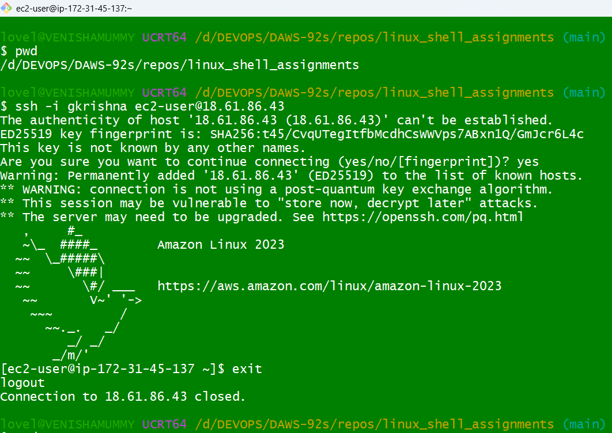 
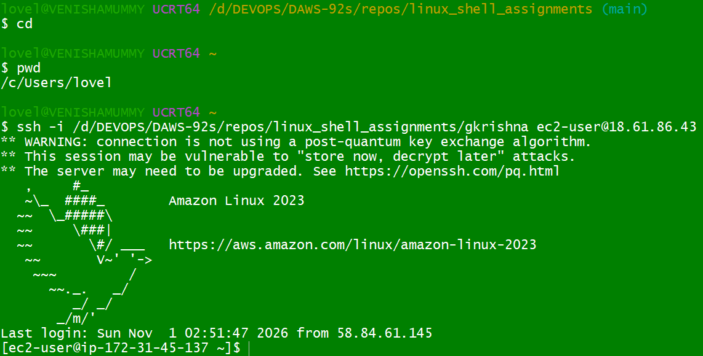

2a> Connect to your EC2 instance using SSH.
---
Ans:
--->> ssh -i gkrishna ec2-user@18.61.86.43 
-->> executed this command from relative path(current directory of keypairs)
---------------------------------------------------------------------------------
lovel@VENISHAMUMMY UCRT64 /d/DEVOPS/DAWS-92s/repos/linux_shell_assignments (main)
$ pwd
/d/DEVOPS/DAWS-92s/repos/linux_shell_assignments

lovel@VENISHAMUMMY UCRT64 /d/DEVOPS/DAWS-92s/repos/linux_shell_assignments (main)
$ ssh -i gkrishna ec2-user@18.61.86.43
The authenticity of host '18.61.86.43 (18.61.86.43)' can't be established.
ED25519 key fingerprint is: SHA256:t45/CvqUTegItfbMcdhCsWWVps7ABxn1Q/GmJcr6L4c
This key is not known by any other names.
Are you sure you want to continue connecting (yes/no/[fingerprint])? yes
Warning: Permanently added '18.61.86.43' (ED25519) to the list of known hosts.
** WARNING: connection is not using a post-quantum key exchange algorithm.
** This session may be vulnerable to "store now, decrypt later" attacks.
** The server may need to be upgraded. See https://openssh.com/pq.html
   ,     #_
   ~\_  ####_        Amazon Linux 2023
  ~~  \_#####\
  ~~     \###|
  ~~       \#/ ___   https://aws.amazon.com/linux/amazon-linux-2023
   ~~       V~' '->
    ~~~         /
      ~~._.   _/
         _/ _/
       _/m/'
[ec2-user@ip-172-31-45-137 ~]$
-----------------------------------------------------------------------------------
--command:
ssh -i /d/DEVOPS/DAWS-92s/repos/linux_shell_assignments/gkrishna ec2-user@18.61.86.43
>>Executed from my homepath. Because i used absolutepath(means the location of the Keypars)
--------------------------------------------------------------------------------------
lovel@VENISHAMUMMY UCRT64 /d/DEVOPS/DAWS-92s/repos/linux_shell_assignments (main)
$ cd
lovel@VENISHAMUMMY UCRT64 ~
$ pwd
/c/Users/lovel
lovel@VENISHAMUMMY UCRT64 ~
$ ssh -i /d/DEVOPS/DAWS-92s/repos/linux_shell_assignments/gkrishna ec2-user@18.61.86.43
** WARNING: connection is not using a post-quantum key exchange algorithm.
** This session may be vulnerable to "store now, decrypt later" attacks.
** The server may need to be upgraded. See https://openssh.com/pq.html
   ,     #_
   ~\_  ####_        Amazon Linux 2023
  ~~  \_#####\
  ~~     \###|
  ~~       \#/ ___   https://aws.amazon.com/linux/amazon-linux-2023
   ~~       V~' '->
    ~~~         /
      ~~._.   _/
         _/ _/
       _/m/'
Last login: Sun Nov  1 02:51:47 2026 from 58.84.61.145
[ec2-user@ip-172-31-45-137 ~]$
--------------------------------------------------------------------------------------------
2b> Confirm you are connected by checking the hostname, current directory, and logged-in username
Ans:
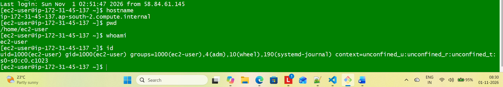
----------------------
Last login: Sun Nov  1 02:51:47 2026 from 58.84.61.145
[ec2-user@ip-172-31-45-137 ~]$ hostname
ip-172-31-45-137.ap-south-2.compute.internal
[ec2-user@ip-172-31-45-137 ~]$ pwd
/home/ec2-user
[ec2-user@ip-172-31-45-137 ~]$ whoami
ec2-user
[ec2-user@ip-172-31-45-137 ~]$ id
uid=1000(ec2-user) gid=1000(ec2-user) groups=1000(ec2-user),4(adm),10(wheel),190(systemd-journal) context=unconfined_u:unconfined_r:unconfined_t:s0-s0:c0.c1023
[ec2-user@ip-172-31-45-137 ~]$
-----------------------
Successfully connected to AWS Linux server using SSH private key.
hostname displayed server name.
pwd displayed current location.
whoami displayed logged in username.
id displayed complete user and group details.
---------------------------------------------------------------------------------------------
3. Your Security Group currently allows SSH from anywhere. Restrict it to your own IP only.
---
Ans:
3a> Your Security Group currently allows SSH from anywhere.
yes, becuase the inbound rule is configured with '0.0.0.0/0' and it's allow all to connect this EC2 Instance.
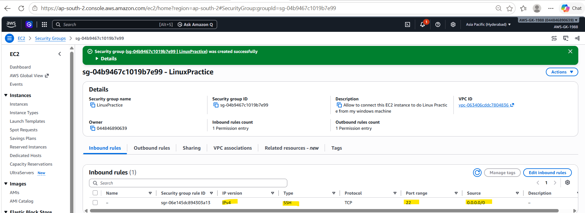
3b> Restrict it to your own IP only.
Ans:
Yes, we can restriced the connectivity of others. So for this can make changes in security group Inbound rule of 'ssh' protocal with '22' port to allow connections only from my machine(winsows/Mac). For security reasons i have striked out my IP.
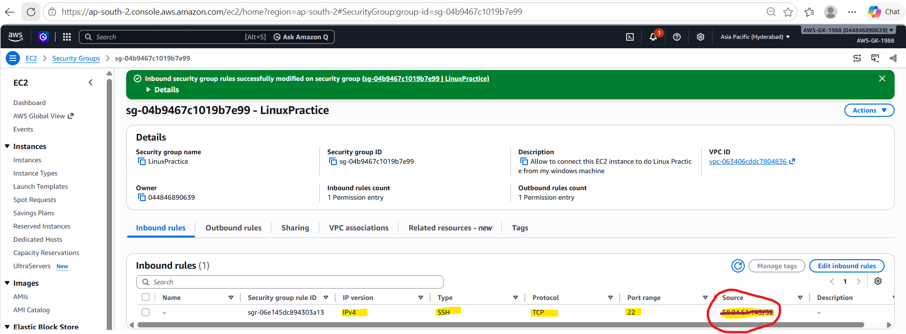
-----------------------------
Initially SSH port was accessible from anywhere on internet.
Updated Security Group to allow SSH only from my public IP.
This improves security and reduces unauthorized access attempts.
-----------------------------------------------------------------------------------------------------
4. Find out which Linux distribution and version is running on the instance.
---
Ans:
See below are the Linux distribution and Version details.
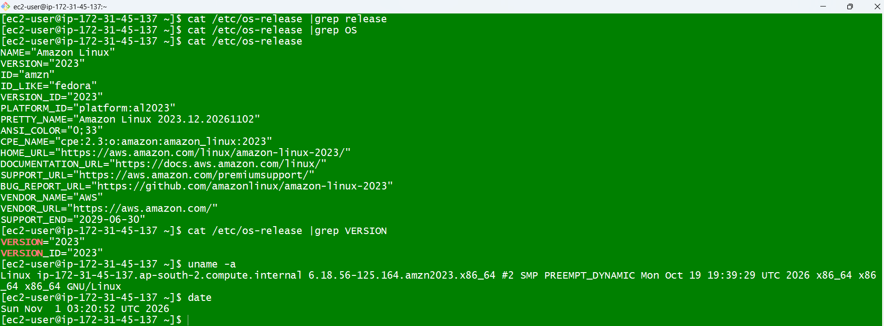
---Commands:
cat /etc/os-release
cat /etc/os-release |grep VERSION
uname -a
---------------------------
[ec2-user@ip-172-31-45-137 ~]$ cat /etc/os-release
NAME="Amazon Linux"
VERSION="2023"
ID="amzn"
ID_LIKE="fedora"
VERSION_ID="2023"
PLATFORM_ID="platform:al2023"
PRETTY_NAME="Amazon Linux 2023.12.20261102"
ANSI_COLOR="0;33"
CPE_NAME="cpe:2.3:o:amazon:amazon_linux:2023"
HOME_URL="https://aws.amazon.com/linux/amazon-linux-2023/"
DOCUMENTATION_URL="https://docs.aws.amazon.com/linux/"
SUPPORT_URL="https://aws.amazon.com/premiumsupport/"
BUG_REPORT_URL="https://github.com/amazonlinux/amazon-linux-2023"
VENDOR_NAME="AWS"
VENDOR_URL="https://aws.amazon.com/"
SUPPORT_END="2029-06-30"
[ec2-user@ip-172-31-45-137 ~]$ cat /etc/os-release |grep VERSION
VERSION="2023"
VERSION_ID="2023"
[ec2-user@ip-172-31-45-137 ~]$ uname -a
Linux ip-172-31-45-137.ap-south-2.compute.internal 6.18.56-125.164.amzn2023.x86_64 #2 SMP PREEMPT_DYNAMIC Mon Oct 19 19:39:29 UTC 2026 x86_64 x86_64 x86_64 GNU/Linux
[ec2-user@ip-172-31-45-137 ~]$
---------------
The command displayed operating system details.
The instance is running Amazon Linux 2023.
Knowing OS details helps while installing software and troubleshooting issues.
-------------------------------------------------------------------------------------------
5. Delete the instance, Security Group, and key pair.
---
Ans:
Deleted EC2 instance, Security Group and Key Pair successfully.
Unused resources should be removed to avoid unnecessary AWS cost and improve security.
Below is the evidence.

===============================================================================================
## Assignment — Linux File Operations
1. Create the following directory structure using a single command:
   ```
   devops/
   └── projects/
       └── batch-90s/
---
Ans:
-------------------------------On windows machine
Created directory structure using a single command.
Option -p automatically creates parent directories if they do not exist.
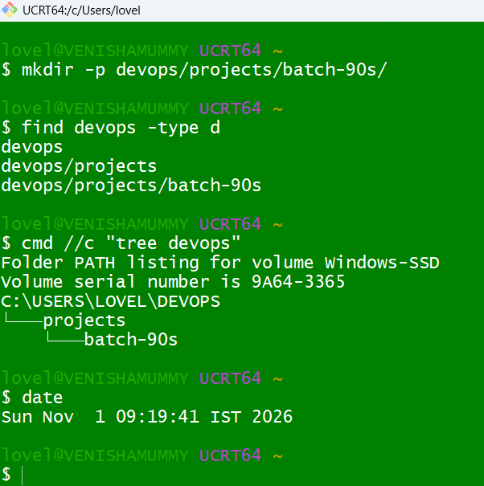

--Command i used here is,
mkdir -p devops/projects/batch-90s/
find devops -type d
cmd //c "tree devops"
-----------------------------------
lovel@VENISHAMUMMY UCRT64 ~
$ mkdir -p devops/projects/batch-90s/

lovel@VENISHAMUMMY UCRT64 ~
$ find devops -type d
devops
devops/projects
devops/projects/batch-90s

lovel@VENISHAMUMMY UCRT64 ~
$ cmd //c "tree devops"
Folder PATH listing for volume Windows-SSD
Volume serial number is 9A64-3365
C:\USERS\LOVEL\DEVOPS
└───projects
    └───batch-90s

lovel@VENISHAMUMMY UCRT64 ~
$ date
Sun Nov  1 09:19:41 IST 2026
lovel@VENISHAMUMMY UCRT64 ~
$
-----------------------------On EC2 Linux Instance or Server
[ec2-user@ip-172-31-45-137 ~]$ pwd
/home/ec2-user
[ec2-user@ip-172-31-45-137 ~]$ mkdir -p devops/projects/batch-90s
[ec2-user@ip-172-31-45-137 ~]$ find devops -type d
devops
devops/projects
devops/projects/batch-90s
[ec2-user@ip-172-31-45-137 ~]$ ls -R devops
devops:
projects
devops/projects:
batch-90s
devops/projects/batch-90s:
[ec2-user@ip-172-31-45-137 ~]$
=======================================================================================
2. Inside `batch-90s/`, create a file called `notes.txt`. Write three lines into it, then append two more. Read it to verify.
---
Ans:
-Commands
cat > notes.txt << EOF
cat >> notes.txt << EOF
cat notes.txt
----------------------------------
[ec2-user@ip-172-31-45-137 batch-90s]$ cat > notes.txt << EOF
> Hi, I am Gopi Krishna and i am learning DevOps Course.
Now, I am trying to complete the Linux assignments.
It will increase my confidence levels.
> EOF
[ec2-user@ip-172-31-45-137 batch-90s]$ cat notes.txt
Hi, I am Gopi Krishna and i am learning DevOps Course.
Now, I am trying to complete the Linux assignments.
It will increase my confidence levels.
[ec2-user@ip-172-31-45-137 batch-90s]$
---
[ec2-user@ip-172-31-45-137 batch-90s]$ cat >> notes.txt << EOF
> I am very greatful to learn this course from one of the top most experienced tutor.
> I want to switch into devops domain from administrator domain.
> EOF
---
[ec2-user@ip-172-31-45-137 batch-90s]$ cat notes.txt
Hi, I am Gopi Krishna and i am learning DevOps Course.
Now, I am trying to complete the Linux assignments.
It will increase my confidence levels.
I am very greatful to learn this course from one of the top most experienced tutor.
I want to switch into devops domain from administrator domain.
[ec2-user@ip-172-31-45-137 batch-90s]$ date
Sun Nov  1 04:21:01 UTC 2026
[ec2-user@ip-172-31-45-137 batch-90s]$
---------------------------
Created notes.txt file and inserted data successfully.
Using (cat > notes.txt << EOF) >>>>> creates the content.
Using (cat >> notes.txt << EOF) >>>> appends data without deleting existing information.
using (cat notes.txt) >>>>> to see the content inside the file.
-------------------------------------------------------------------------------------------------
3. Copy `notes.txt` to `projects/` and rename the copy to `backup.txt`. Verify both exist.
---
Ans:
--Commands:
cp notes.txt /home/ec2-user/devops/projects/ ---copying/moving the file into 'projects' folder.
ls /home/ec2-user/devops/projects ---to check the contenets/verify the file moved or not.
cp notes.txt backup.txt ---Make a copy of the file(like backup)
mv notes.txt backup.txt ---renaming the file.
------------
[ec2-user@ip-172-31-45-137 batch-90s]$ pwd
/home/ec2-user/devops/projects/batch-90s
[ec2-user@ip-172-31-45-137 batch-90s]$ ll
total 4
-rw-r--r--. 1 ec2-user ec2-user 293 Nov  1 04:20 notes.txt
[ec2-user@ip-172-31-45-137 batch-90s]$ cp notes.txt /home/ec2-user/devops/projects/
[ec2-user@ip-172-31-45-137 projects]$ ls /home/ec2-user/devops/projects
backup.txt  batch-90s
[ec2-user@ip-172-31-45-137 batch-90s]$ cd /home/ec2-user/devops/projects
[ec2-user@ip-172-31-45-137 projects]$ ll
total 4
drwxr-xr-x. 2 ec2-user ec2-user  23 Nov  1 04:48 batch-90s
-rw-r--r--. 1 ec2-user ec2-user 293 Nov  1 04:49 notes.txt
[ec2-user@ip-172-31-45-137 projects]$ cp notes.txt backup.txt
[ec2-user@ip-172-31-45-137 projects]$ ll
total 8
-rw-r--r--. 1 ec2-user ec2-user 293 Nov  1 04:50 backup.txt
drwxr-xr-x. 2 ec2-user ec2-user  23 Nov  1 04:48 batch-90s
-rw-r--r--. 1 ec2-user ec2-user 293 Nov  1 04:49 notes.txt
[ec2-user@ip-172-31-45-137 projects]$ mv notes.txt backup.txt
[ec2-user@ip-172-31-45-137 projects]$ ll
total 4
-rw-r--r--. 1 ec2-user ec2-user 293 Nov  1 04:49 backup.txt
drwxr-xr-x. 2 ec2-user ec2-user  23 Nov  1 04:48 batch-90s
[ec2-user@ip-172-31-45-137 projects]$
---------------------------------------------------------------------------------------------------
4. Move `backup.txt` to `/tmp/`. What happens to files there when the server restarts?
---
Ans: backup.txt file was successfully moved to /tmp directory.
------------------------
[ec2-user@ip-172-31-45-137 projects]$ mv backup.txt /tmp
[ec2-user@ip-172-31-45-137 projects]$ cd /tmp
[ec2-user@ip-172-31-45-137 tmp]$ ll
total 4
-rw-r--r--. 1 ec2-user ec2-user 293 Nov  1 04:49 backup.txt
--------------------------
What happens to files there when the server restarts?
Ans: 
The /tmp directory is used for temporary storage and files may be removed automatically during reboot or cleanup operations.
--------------------------------------------------------------------------------------------------
5. Delete the `devops/` directory and everything inside it.
---
Ans:
--command:
rm -rf devops
ls devops
ll
----------------------------------
[ec2-user@ip-172-31-45-137 ~]$ pwd
/home/ec2-user
[ec2-user@ip-172-31-45-137 ~]$ ls devops
projects
[ec2-user@ip-172-31-45-137 ~]$ ls devops/projects
batch-90s
[ec2-user@ip-172-31-45-137 ~]$ ls devops/projects/batch-90s
notes.txt
[ec2-user@ip-172-31-45-137 ~]$ rm -rf devops
[ec2-user@ip-172-31-45-137 ~]$ ls devops
ls: cannot access 'devops': No such file or directory
[ec2-user@ip-172-31-45-137 ~]$ ll
total 0
[ec2-user@ip-172-31-45-137 ~]$ date
Sun Nov  1 05:03:10 UTC 2026
[ec2-user@ip-172-31-45-137 ~]$
---------------------------------------
Deleted complete directory structure and all files inside it.
Option -r removes directories recursively and -f forces deletion without confirmation.
-----------------------------------------------------------------------------------------------
6. List the contents of `/var/log/` sorted by time. What do you notice? Why would a DevOps engineer check this directory?
---
Ans:
-Command
ls -ltr /var/log or ls -ltr `/var/log/`
----------------------------------
[ec2-user@ip-172-31-45-137 ~]$ ls -ltr /var/log/
total 180
drwxr-x---. 2 root   root                 6 Jul 14 17:05 sssd
-rw-------. 1 root   root                 0 Oct 30 02:01 tallylog
lrwxrwxrwx. 1 root   root                39 Oct 30 02:01 README -> ../../usr/share/doc/systemd/README.logs
drwx------. 2 root   root                 6 Oct 30 02:01 private
-rw-rw----. 1 root   utmp                 0 Oct 30 02:01 btmp
drwxr-sr-x+ 3 root   systemd-journal     46 Nov  1 02:45 journal
drwx------. 2 root   root                23 Nov  1 02:45 audit
drwxr-xr-x. 2 root   root                18 Nov  1 02:45 sa
drwxr-xr-x. 3 root   root                17 Nov  1 02:45 amazon
-rw-r-----. 1 root   adm               3686 Nov  1 02:45 cloud-init-output.log
-rw-r-----. 1 root   adm             149861 Nov  1 02:45 cloud-init.log
-rw-r--r--. 1 root   root                58 Nov  1 02:45 dnf.rpm.log
-rw-r--r--. 1 root   root                60 Nov  1 02:45 hawkey.log
-rw-r--r--. 1 root   root              1181 Nov  1 02:45 dnf.log
-rw-r--r--. 1 root   root              1698 Nov  1 02:45 dnf.librepo.log
drwxr-x---. 2 chrony chrony              72 Nov  1 02:45 chrony
-rw-rw-r--. 1 root   utmp              4224 Nov  1 03:59 wtmp
-rw-rw-r--. 1 root   utmp            292292 Nov  1 03:59 lastlog
[ec2-user@ip-172-31-45-137 ~]$ ls -ltr '/var/log/'
total 180
drwxr-x---. 2 root   root                 6 Jul 14 17:05 sssd
-rw-------. 1 root   root                 0 Oct 30 02:01 tallylog
lrwxrwxrwx. 1 root   root                39 Oct 30 02:01 README -> ../../usr/share/doc/systemd/README.logs
drwx------. 2 root   root                 6 Oct 30 02:01 private
-rw-rw----. 1 root   utmp                 0 Oct 30 02:01 btmp
drwxr-sr-x+ 3 root   systemd-journal     46 Nov  1 02:45 journal
drwx------. 2 root   root                23 Nov  1 02:45 audit
drwxr-xr-x. 2 root   root                18 Nov  1 02:45 sa
drwxr-xr-x. 3 root   root                17 Nov  1 02:45 amazon
-rw-r-----. 1 root   adm               3686 Nov  1 02:45 cloud-init-output.log
-rw-r-----. 1 root   adm             149861 Nov  1 02:45 cloud-init.log
-rw-r--r--. 1 root   root                58 Nov  1 02:45 dnf.rpm.log
-rw-r--r--. 1 root   root                60 Nov  1 02:45 hawkey.log
-rw-r--r--. 1 root   root              1181 Nov  1 02:45 dnf.log
-rw-r--r--. 1 root   root              1698 Nov  1 02:45 dnf.librepo.log
drwxr-x---. 2 chrony chrony              72 Nov  1 02:45 chrony
-rw-rw-r--. 1 root   utmp              4224 Nov  1 03:59 wtmp
-rw-rw-r--. 1 root   utmp            292292 Nov  1 03:59 lastlog
[ec2-user@ip-172-31-45-137 ~]$
----------------------------------
-What do you notice?
Ans: 
Log files are continuously updated by Linux services and applications.
-Why would a DevOps engineer check this directory?
Ans:
DevOps engineers check this location for troubleshooting, service failures and system activity investigations.
================================================================================================
---
## Assignment — Linux Text Processing
Create a file with this content:
```
web-server-01 192.168.1.10 running
web-server-02 192.168.1.11 stopped
db-server-01  192.168.1.20 running
db-server-02  192.168.1.21 running
cache-server  192.168.1.30 stopped
```
Write a command for each:
------------------------------
[ec2-user@ip-172-31-45-137 ~]$ awk "{print $2}" servers.txt
web-server-01 192.168.1.10 running
web-server-02 192.168.1.11 stopped
db-server-01  192.168.1.20 running
db-server-02  192.168.1.21 running
cache-server  192.168.1.30 stopped
[ec2-user@ip-172-31-45-137 ~]$ awk "{print $1}" servers.txt
web-server-01 192.168.1.10 running
web-server-02 192.168.1.11 stopped
db-server-01  192.168.1.20 running
db-server-02  192.168.1.21 running
cache-server  192.168.1.30 stopped
[ec2-user@ip-172-31-45-137 ~]$
-------------------------------Explanation---------------------
Issue:
I used double quotes instead of single quotes in awk command.
Wrong:
awk "{print $2}" servers.txt
Correct:
awk '{print $2}' servers.txt
Reason:
Inside double quotes, shell tries to interpret $1, $2 as shell variables before passing them to awk.
Using single quotes passes the awk program exactly as written to awk.
--------------------------------

1. Show only lines where the server is `running`.
---
Ans:
-commands
grep running servers.txt
cat servers.txt |grep running
---------------------------------------------
[ec2-user@ip-172-31-45-137 ~]$ grep running servers.txt
web-server-01 192.168.1.10 running
db-server-01  192.168.1.20 running
db-server-02  192.168.1.21 running
[ec2-user@ip-172-31-45-137 ~]$ cat servers.txt |grep running
web-server-01 192.168.1.10 running
db-server-01  192.168.1.20 running
db-server-02  192.168.1.21 running
[ec2-user@ip-172-31-45-137 ~]$
----------------------------------------------
2. Show only lines where the server is NOT `running`.
---
Ans:
-command:
grep -v running servers.txt
cat servers.txt |grep -v running
-----------------------------------------------
[ec2-user@ip-172-31-45-137 ~]$ grep -v running servers.txt
web-server-02 192.168.1.11 stopped
cache-server  192.168.1.30 stopped
[ec2-user@ip-172-31-45-137 ~]$ cat servers.txt |grep -v running
web-server-02 192.168.1.11 stopped
cache-server  192.168.1.30 stopped
[ec2-user@ip-172-31-45-137 ~]$
-----------------------------------------------
3. Count how many servers are `running`.
---
Ans:
-command:
grep running servers.txt |wc -l
cat servers.txt |grep running |wc -l
----------------------------------------------
[ec2-user@ip-172-31-45-137 ~]$ grep running servers.txt |wc -l
3
[ec2-user@ip-172-31-45-137 ~]$ cat servers.txt |grep running |wc -l
3
[ec2-user@ip-172-31-45-137 ~]$
----------------------------------------------
4. Show the first 3 lines. Then show the last 2.
---
Ans:
-Commands:
cat servers.txt |head -3
head -3 servers.txt
-
cat servers.txt |tail -2
tail -2 servers.txt
---------------------------------------------
[ec2-user@ip-172-31-45-137 ~]$ cat servers.txt |head -3
web-server-01 192.168.1.10 running
web-server-02 192.168.1.11 stopped
db-server-01  192.168.1.20 running
[ec2-user@ip-172-31-45-137 ~]$ head -3 servers.txt
web-server-01 192.168.1.10 running
web-server-02 192.168.1.11 stopped
db-server-01  192.168.1.20 running
[ec2-user@ip-172-31-45-137 ~]$
----------
[ec2-user@ip-172-31-45-137 ~]$ cat servers.txt |tail -2
db-server-02  192.168.1.21 running
cache-server  192.168.1.30 stopped
[ec2-user@ip-172-31-45-137 ~]$ tail -2 servers.txt
db-server-02  192.168.1.21 running
cache-server  192.168.1.30 stopped
[ec2-user@ip-172-31-45-137 ~]$
----------------------------------------------
5. Extract only the IP addresses.
---
Ans:
-command:
awk '{print}' servers.txt
awk '{print $2}' servers.txt
------
awk command extracted the second column from every line.
This is useful when creating server inventories or checking network information
----------------------------------------------
[ec2-user@ip-172-31-45-137 ~]$ awk '{print}' servers.txt
web-server-01 192.168.1.10 running
web-server-02 192.168.1.11 stopped
db-server-01  192.168.1.20 running
db-server-02  192.168.1.21 running
cache-server  192.168.1.30 stopped
[ec2-user@ip-172-31-45-137 ~]$ awk '{print $2}' servers.txt
192.168.1.10
192.168.1.11
192.168.1.20
192.168.1.21
192.168.1.30
--------------------------------------------------
6. Extract only the server names.
---
Ans:
-command:
awk '{print $1}' servers.txt
-------
awk extracted the first column from each record.
This helps when preparing reports or filtering specific servers for administration activities.
-------------------------------------------------
[ec2-user@ip-172-31-45-137 ~]$ awk '{print $1}' servers.txt
web-server-01
web-server-02
db-server-01
db-server-02
cache-server
[ec2-user@ip-172-31-45-137 ~]$ 
----------------------------------------------------
7. Show only the names of `stopped` servers — in one command.
---
Ans:
-command:
awk '$3=="stopped" {print $1}' servers.txt
awk '$3=="stopped" {print $1,$3}' servers.txt
----
awk can filter and extract information in a single command.
Filtered stopped servers and displayed only their names and thier status too.
---------------------------------------------------
[ec2-user@ip-172-31-45-137 ~]$ awk '$3=="stopped" {print $1}' servers.txt
web-server-02
cache-server
[ec2-user@ip-172-31-45-137 ~]$ awk '$3=="stopped" {print $1,$3}' servers.txt
web-server-02 stopped
cache-server stopped
[ec2-user@ip-172-31-45-137 ~]$
==============================================================================================
---
## Assignment — wget, curl, and Pipes

1. Download the following file to your EC2 instance and save it as `session-notes.txt`:
   ```
   https://raw.githubusercontent.com/daws-90s/notes/refs/heads/main/session-02.txt
   ```
--------------------'wget'-usage------------
Ans:
-command: '-O' --is used to save the file with custom name and it's capital 'O'.
wget  sssion-notes.txt https://raw.githubusercontent.com/daws-90s/notes/refs/heads/main/session-02.txt
wget -O session-notes.txt https://raw.githubusercontent.com/daws-90s/notes/refs/heads/main/session-02.txt

curl session-notes.txt https://raw.githubusercontent.com/daws-90s/notes/refs/heads/main/session-02.txt
curl -O https://raw.githubusercontent.com/daws-90s/notes/refs/heads/main/session-02.txt
curl -o session-notes.txt https://raw.githubusercontent.com/daws-90s/notes/refs/heads/main/session-02.txt
-------------
Successfully downloaded the file from GitHub repository.
Option -O (capital)is used to save the downloaded content with a custom file name.
Without -O, wget uses the original file name available in the URL.
------------------------------------------------
[ec2-user@ip-172-31-45-137 ~]$ wget -O session-notes.txt https://raw.githubusercontent.com/daws-90s/notes/refs/heads/main/session-02.txt
--2026-11-01 06:44:31--  https://raw.githubusercontent.com/daws-90s/notes/refs/heads/main/session-02.txt
Resolving raw.githubusercontent.com (raw.githubusercontent.com)... 185.199.111.133, 185.199.110.133, 185.199.109.133, ...
Connecting to raw.githubusercontent.com (raw.githubusercontent.com)|185.199.111.133|:443... connected.
HTTP request sent, awaiting response... 200 OK
Length: 2993 (2.9K) [text/plain]
Saving to: ‘session-notes.txt’

session-notes.txt                          100%[========================================================================================>]   2.92K  --.-KB/s    in 0s

2026-11-01 06:44:31 (31.8 MB/s) - ‘session-notes.txt’ saved [2993/2993]

[ec2-user@ip-172-31-45-137 ~]$ ll
total 8
-rw-r--r--. 1 ec2-user ec2-user  175 Nov  1 05:44 servers.txt
-rw-r--r--. 1 ec2-user ec2-user 2993 Nov  1 06:44 session-notes.txt
[ec2-user@ip-172-31-45-137 ~]$


----------------------------'curl'-usage-------------------
-----------
curl fetched the file content directly from the URL and displayed it on the terminal. Unlike wget, by default 'curl' does not save the content into a file.
If you use the capital '-O' option it will save the file with original name. If you mention the custom name for the file with small '-o <customname>' it will save the file with defined custom name.
-------------
[ec2-user@ip-172-31-45-137 ~]$ curl https://raw.githubusercontent.com/daws-90s/notes/refs/heads/main/session-02.txt
Regions and AZ

HYD -> Region
North HYD -> AZ-1
South HYD -> AZ-2

Region has atleast 2 or many

us-east-1 -> N.Virginia -> cheapest region, new services are going to be launched here

latency -> may be high, we can't notice

6AZ, 2AZ

order server, install OS, Power connection, Network, AC, Physical security, storage, etc...

Migrate to cloud

IP enabled device...

OS -> Embedded Linux -> Bridge between user and hardware
RAM
HD
Processor

Windows vs Linux
================
User interface is heavy in windows -> slow, Linux is super speed
Linux is more secure than windows
        Low power
        Low bandwidth
        Low ram
        Long running servers
        Linux is open source -> almost free

Linux -> Kernel
Linus Torvalds -> Git, Linux

IBM BIOS(PC), Server(Hardware+OS) -> Unix

Hardware+Software -> Tight coupling
Dell ->

Linux -> using C language from the scratch -> Unix Principles

Kernel -> like heart and brain(Hardware interaction)
Linux is kernel

Oracle, Redhat, Debian, etc. -> distributions/flavours
99% same
1%

Opensource -> community support
Enterprise -> support, if problem comes, they join our and resolve the issue asap

Redhat Enterprise Linux -> RHEL == centos == AWS Linux == fedora ==> RedHat family

AWS Linux 2023 ->
Redhat image

Authentication and Firewall
===========================

1. What you know -> username and password
2. What you have -> RSA Token, Authenticators, Public key and private key etc..
3. What you are -> Retina, plam, fingerprint, etc..

ssh-keygen -f <file-name> -> it will generate two keys. public and private

git -> interact with git repos, mini linux(we can use some linux commands in windows)

pwd -> present working directory

/c/Users/siva

/c/Users/ramesh

C:\devops\daws-90s -> windows format
/c/devops/daws-90s -> linux format

cd -> change directory

Firewall -> authorised persons only will have access

inbound/ingress -> incoming traffic -> we check and allow
outbound/egress -> outgoing traffic -> usually we allow egress traffic everyone

SSH -> Secure shell -> protocol to connect Linux servers terminal access

http -> hyper text transfer protocol
https, ftp, ssh, mysql, smtp, dhcp, udp, tcp, etc...

Connection/Communication between multiple computers

https://facebook.com:443 -> facebook DB
http://facebook.com:80

0-65,535 = 65,536 ports

protocol, ip, port number, authentication

ssh facebook server -> admin access

ssh -> 22

firewall/security group -> SSH 22 allow 0.0.0.0/0 (anyone can connect)

ssh -i <private-key> ec2-user@IP-address

1. read the description of error
2. then search in google, gpt
3. put in slack
4. join qa sessions

/home/<user-name> -> ec2-user -> AWS default user

command -> understand the usage

command <options> <inputs>
-a -> single char -> short version
--all -> all information

2 types of users
1. normal user -> $
2. admin user -> #

sudo su -> super user

absolute path -> from starting
relative path -> from where you are

/c/devops/daws-90s -> absolute path
daws-90s/daws-90s

Linux commands[ec2-user@ip-172-31-45-137 ~]$
--------------------------------------------
[ec2-user@ip-172-31-45-137 ~]$ curl -O https://raw.githubusercontent.com/daws-90s/notes/refs/heads/main/session-02.txt
  % Total    % Received % Xferd  Average Speed  Time    Time    Time   Current
                                 Dload  Upload  Total   Spent   Left   Speed
100   2993 100   2993   0      0 150.5k      0                              0
[ec2-user@ip-172-31-45-137 ~]$ ll
total 12
-rw-r--r--. 1 ec2-user ec2-user  175 Nov  1 05:44 servers.txt
-rw-r--r--. 1 ec2-user ec2-user 2993 Nov  1 06:56 session-02.txt
-rw-r--r--. 1 ec2-user ec2-user 2993 Nov  1 06:44 session-notes.txt
[ec2-user@ip-172-31-45-137 ~]$ date
Sun Nov  1 06:56:53 UTC 2026
[ec2-user@ip-172-31-45-137 ~]$
--------------------------------------------
[ec2-user@ip-172-31-45-137 ~]$ curl -o session-notes.txt https://raw.githubusercontent.com/daws-90s/notes/refs/heads/main/session-02.txt
  % Total    % Received % Xferd  Average Speed  Time    Time    Time   Current
                                 Dload  Upload  Total   Spent   Left   Speed
100   2993 100   2993   0      0 145.6k      0                              0
[ec2-user@ip-172-31-45-137 ~]$ ll
total 12
-rw-r--r--. 1 ec2-user ec2-user  175 Nov  1 05:44 servers.txt
-rw-r--r--. 1 ec2-user ec2-user 2993 Nov  1 06:56 session-02.txt
-rw-r--r--. 1 ec2-user ec2-user 2993 Nov  1 07:02 session-notes.txt
[ec2-user@ip-172-31-45-137 ~]$ date
Sun Nov  1 07:03:06 UTC 2026
[ec2-user@ip-172-31-45-137 ~]$
------------------------------------------------------------------------------------------------------------------

2. Fetch the same file using `curl` and count its lines — without saving it to disk.
---
Ans:
-command:
curl https://raw.githubusercontent.com/daws-90s/notes/refs/heads/main/session-02.txt|wc -l
curl -S https://raw.githubusercontent.com/daws-90s/notes/refs/heads/main/session-02.txt|wc -l
curl -s https://raw.githubusercontent.com/daws-90s/notes/refs/heads/main/session-02.txt|wc -l  
-------
Fetched file contents directly from URL and counted total lines. No file was stored locally which saves disk space. 
--------------------------------
[ec2-user@ip-172-31-45-137 ~]$ curl https://raw.githubusercontent.com/daws-90s/notes/refs/heads/main/session-02.txt|wc -l
  % Total    % Received % Xferd  Average Speed  Time    Time    Time   Current
                                 Dload  Upload  Total   Spent   Left   Speed
100   2993 100   2993   0      0  10570      0                              0
134
[ec2-user@ip-172-31-45-137 ~]$ curl -S https://raw.githubusercontent.com/daws-90s/notes/refs/heads/main/session-02.txt|wc -l
  % Total    % Received % Xferd  Average Speed  Time    Time    Time   Current
                                 Dload  Upload  Total   Spent   Left   Speed
100   2993 100   2993   0      0 143.0k      0                              0
134
[ec2-user@ip-172-31-45-137 ~]$ curl -s https://raw.githubusercontent.com/daws-90s/notes/refs/heads/main/session-02.txt|wc -l
134
[ec2-user@ip-172-31-45-137 ~]$
----------------------------------------
3. Fetch the file and print only lines containing `Linux` — in one command.
---
Ans:
Command:
curl -s https://raw.githubusercontent.com/daws-90s/notes/refs/heads/main/session-02.txt|grep linux
curl -s https://raw.githubusercontent.com/daws-90s/notes/refs/heads/main/session-02.txt|grep Linux
curl -s https://raw.githubusercontent.com/daws-90s/notes/refs/heads/main/session-02.txt|grep -i linux
------
these commands are displaying only lines containing the word Linux and grep helps search specific patterns inside data streams.
-----------------------------------
git -> interact with git repos, mini linux(we can use some linux commands in windows)
/c/devops/daws-90s -> linux format
[ec2-user@ip-172-31-45-137 ~]$ curl -s https://raw.githubusercontent.com/daws-90s/notes/refs/heads/main/session-02.txt|grep Linux
OS -> Embedded Linux -> Bridge between user and hardware
Windows vs Linux
User interface is heavy in windows -> slow, Linux is super speed
Linux is more secure than windows
        Linux is open source -> almost free
Linux -> Kernel
Linus Torvalds -> Git, Linux
Linux -> using C language from the scratch -> Unix Principles
Linux is kernel
Redhat Enterprise Linux -> RHEL == centos == AWS Linux == fedora ==> RedHat family
AWS Linux 2023 ->
SSH -> Secure shell -> protocol to connect Linux servers terminal access
Linux commands
[ec2-user@ip-172-31-45-137 ~]$ curl -s https://raw.githubusercontent.com/daws-90s/notes/refs/heads/main/session-02.txt|grep -i linux
OS -> Embedded Linux -> Bridge between user and hardware
Windows vs Linux
User interface is heavy in windows -> slow, Linux is super speed
Linux is more secure than windows
        Linux is open source -> almost free
Linux -> Kernel
Linus Torvalds -> Git, Linux
Linux -> using C language from the scratch -> Unix Principles
Linux is kernel
Redhat Enterprise Linux -> RHEL == centos == AWS Linux == fedora ==> RedHat family
AWS Linux 2023 ->
git -> interact with git repos, mini linux(we can use some linux commands in windows)
/c/devops/daws-90s -> linux format
SSH -> Secure shell -> protocol to connect Linux servers terminal access
Linux commands
[ec2-user@ip-172-31-45-137 ~]$
---------------------------------------------------------------------------------------------------------------------------------
4. Run this and explain what `$NF` means:
   ```bash
   echo "https://raw.githubusercontent.com/daws-90s/notes/refs/heads/main/session-02.txt" | awk -F "/" '{print $NF}'
   ```
---
Ans:
NF means Number Of Fields in awk. $NF represents the last field of the input.
In this example it extracts the filename from the URL.
-----------
[ec2-user@ip-172-31-45-137 ~]$ echo "https://raw.githubusercontent.com/daws-90s/notes/refs/heads/main/session-02.txt" | awk -F "/" '{print $NF}'
session-02.txt
[ec2-user@ip-172-31-45-137 ~]$
--------------------------------------------------------------------------------------------------------------------------------
5. Fetch the file, filter lines containing `ssh`, then count how many matched — using two pipes.
---
Ans:
Commands:
curl -s https://raw.githubusercontent.com/daws-90s/notes/refs/heads/main/session-02.txt | grep ssh
curl -s https://raw.githubusercontent.com/daws-90s/notes/refs/heads/main/session-02.txt | grep ssh |wc -l
curl -s https://raw.githubusercontent.com/daws-90s/notes/refs/heads/main/session-02.txt | grep -i ssh
ecurl -s https://raw.githubusercontent.com/daws-90s/notes/refs/heads/main/session-02.txt | grep -i ssh |wc -l
-----------
grep command is case-sensitive by default. grep ssh searched only lowercase ssh entries and returned 5 matches.
grep -i ssh ignored case and searched both ssh and SSH entries, therefore returned 7 matches. 
Option -i is useful when we do not know the exact capitalization of the text.
----------------------------
[ec2-user@ip-172-31-45-137 ~]$ curl -s https://raw.githubusercontent.com/daws-90s/notes/refs/heads/main/session-02.txt | grep ssh
ssh-keygen -f <file-name> -> it will generate two keys. public and private
https, ftp, ssh, mysql, smtp, dhcp, udp, tcp, etc...
ssh facebook server -> admin access
ssh -> 22
ssh -i <private-key> ec2-user@IP-address
[ec2-user@ip-172-31-45-137 ~]$ curl -s https://raw.githubusercontent.com/daws-90s/notes/refs/heads/main/session-02.txt | grep ssh |wc -l
5
[ec2-user@ip-172-31-45-137 ~]$ curl -s https://raw.githubusercontent.com/daws-90s/notes/refs/heads/main/session-02.txt | grep -i ssh
ssh-keygen -f <file-name> -> it will generate two keys. public and private
SSH -> Secure shell -> protocol to connect Linux servers terminal access
https, ftp, ssh, mysql, smtp, dhcp, udp, tcp, etc...
ssh facebook server -> admin access
ssh -> 22
firewall/security group -> SSH 22 allow 0.0.0.0/0 (anyone can connect)
ssh -i <private-key> ec2-user@IP-address
[ec2-user@ip-172-31-45-137 ~]$ curl -s https://raw.githubusercontent.com/daws-90s/notes/refs/heads/main/session-02.txt | grep -i ssh |wc -l
[ec2-cxuser@ip-172-31-45-137 ~]$
======================================================================================================================================

## Assignment — /etc/passwd Deep Dive

1. How many user accounts exist on the system?
---
Ans:
-Command:
cat /etc/passwd |wc -l
wc -l /etc/passwd
awk -F ':' '{print $1}' /etc/passwd|wc -l

----------------------------------------
[ec2-user@ip-172-31-45-137 ~]$ wc -l /etc/passwd
28 /etc/passwd

[ec2-user@ip-172-31-45-137 ~]$ cat /etc/passwd |wc -l
28

[ec2-user@ip-172-31-45-137 ~]$
[ec2-user@ip-172-31-45-137 ~]$ awk -F ':' '{print $1}' /etc/passwd|wc -l
28
[ec2-user@ip-172-31-45-137 ~]$


----------------------------------------
2. Extract only the usernames.
---
Ans:
-Command:
awk -F ':' '{print $1}' /etc/passwd
cut -d ':' -f1 /etc/passwd
-----------------------------
[ec2-user@ip-172-31-45-137 ~]$ awk -F ':' '{print $1}' /etc/passwd
root
bin
daemon
adm
lp
sync
shutdown
halt
mail
operator
games
ftp
nobody
dbus
systemd-network
systemd-oom
systemd-resolve
rpc
libstoragemgmt
systemd-coredump
systemd-timesync
sshd
chrony
ec2-instance-connect
stapunpriv
rpcuser
tcpdump
ec2-user
--------
[ec2-user@ip-172-31-45-137 ~]$ cut -d ':' -f1 /etc/passwd
root
bin
daemon
adm
lp
sync
shutdown
halt
mail
operator
games
ftp
nobody
dbus
systemd-network
systemd-oom
systemd-resolve
rpc
libstoragemgmt
systemd-coredump
systemd-timesync
sshd
chrony
ec2-instance-connect
stapunpriv
rpcuser
tcpdump
ec2-user
[ec2-user@ip-172-31-45-137 ~]$
------------------------------
3. Show only users with UID greater than 999.
---
Ans:
Command:
awk -F ':' '$3>999 {print $1,$3}' /etc/passwd
awk -F ':' '$3>999 {print $1}' /etc/passwd
-----------------------------------
[ec2-user@ip-172-31-45-137 ~]$ awk -F ':' '$3>999 {print $1,$3}' /etc/passwd
nobody 65534
ec2-user 1000
[ec2-user@ip-172-31-45-137 ~]$ awk -F ':' '$3>999 {print $1}' /etc/passwd
nobody
ec2-user
[ec2-user@ip-172-31-45-137 ~]$
----------------------------------
4. Find the entry for `ec2-user`. What is their home directory?
---
Ans:
Command:
awk -F ':'  '$1=="ec2-user" {print $1,$6}' /etc/passwd
grep 'ec2-user' /etc/passwd
cat /etc/passwd | awk -F ':'  '$1=="ec2-user" {print $1,$6}'
----------------------------------------
[ec2-user@ip-172-31-45-137 ~]$ awk -F ':'  '$1=="ec2-user" {print $1,$6}' /etc/passwd
ec2-user /home/ec2-user
[ec2-user@ip-172-31-45-137 ~]$ grep 'ec2-user' /etc/passwd
ec2-user:x:1000:1000:EC2 Default User:/home/ec2-user:/bin/bash
[ec2-user@ip-172-31-45-137 ~]$
[ec2-user@ip-172-31-45-137 ~]$ cat /etc/passwd | awk -F ':'  '$1=="ec2-user" {print $1,$6}'
ec2-user /home/ec2-user
[ec2-user@ip-172-31-45-137 ~]$
---------------------------------------
5. List all unique login shells assigned to users on the system.
---
Ans:
Command:
cut -d ':' -f7 /etc/passwd|sort -u
cat /etc/passwd | cut -d ':' -f7 |sort -u
--------------------------------------------
[ec2-user@ip-172-31-45-137 ~]$ cut -d ':' -f7 /etc/passwd|sort -u
/bin/bash
/bin/sync
/sbin/halt
/sbin/nologin
/sbin/shutdown
/usr/sbin/nologin
[ec2-user@ip-172-31-45-137 ~]$
---
cat /etc/passwd | cut -d ':' -f7 |sort -u
/bin/bash
/bin/sync
/sbin/halt
/sbin/nologin
/sbin/shutdown
/usr/sbin/nologin
[ec2-user@ip-172-31-45-137 ~]$
==============================================================================================================================
---
## Assignment — Vim Editor

1. Create `practice.txt` using vim. Add 10 lines of content, save and exit.
---
Ans:
Command:
vim practice.txt
:wq
cat practice.txt
----------------------------
[ec2-user@ip-172-31-45-137 ~]$ vim practice.txt
[ec2-user@ip-172-31-45-137 ~]$ cat practice.txt
Linux is an open source operating system.
I am learning Linux administration.
DevOps engineers use Linux servers daily.
SSH is used to connect Linux servers remotely.
Linux permissions control file access.
Vim is a powerful text editor in Linux.
AWS EC2 instances often run Linux.
System administrators monitor Linux log files.
Linux commands help automate daily tasks.
Practice makes Linux administration easier.
[ec2-user@ip-172-31-45-137 ~]$
----------------------------
2. Open the file. Turn on line numbers, jump to line 7, delete line 3, save and exit.
---
Ans:
Commands:
:set nu ---set line numbers
:7 ---move to 7th line
:3d ---delete 3rd line
:wq --save and exit
------------------------------------
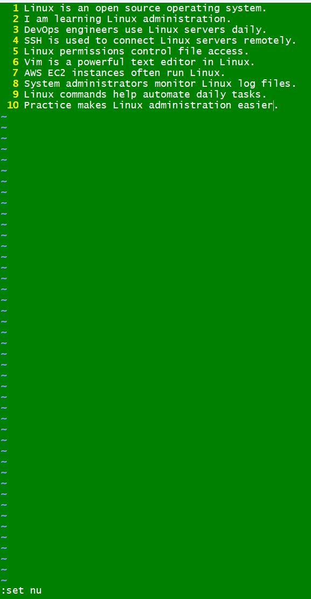 
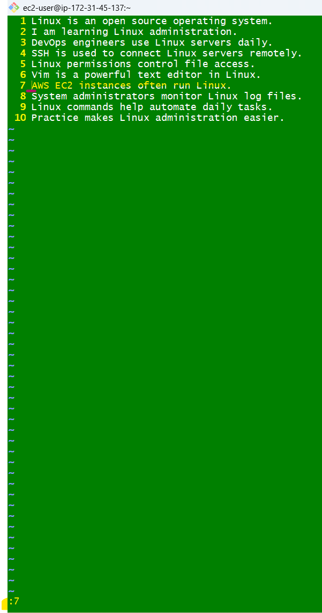
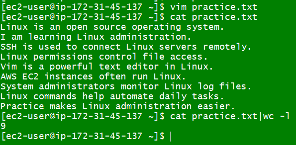
-----------------------------------
3. Open the file. Search for a word, move through its occurrences, then clear the highlight.
---
Ans:
Commands:
/Linux ---forward search
?Linux ---backward search
n --move to next occurance up-direction
N --move to next occurance down-direction
:noh
-----------------------------------
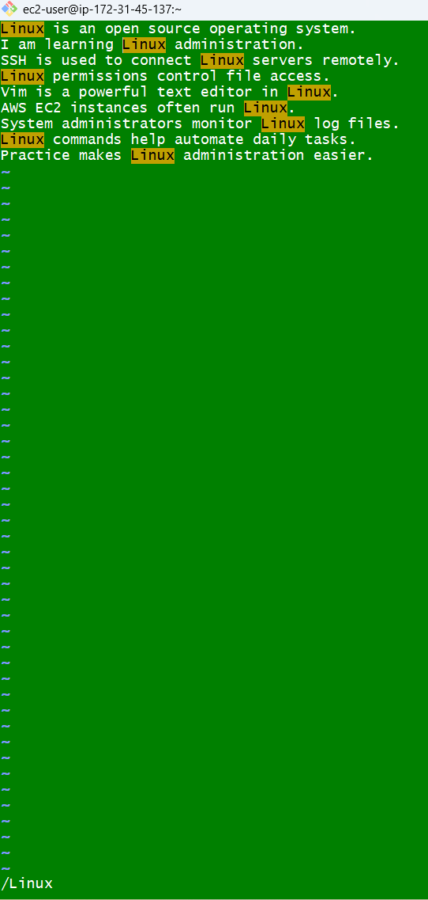 --/Linux
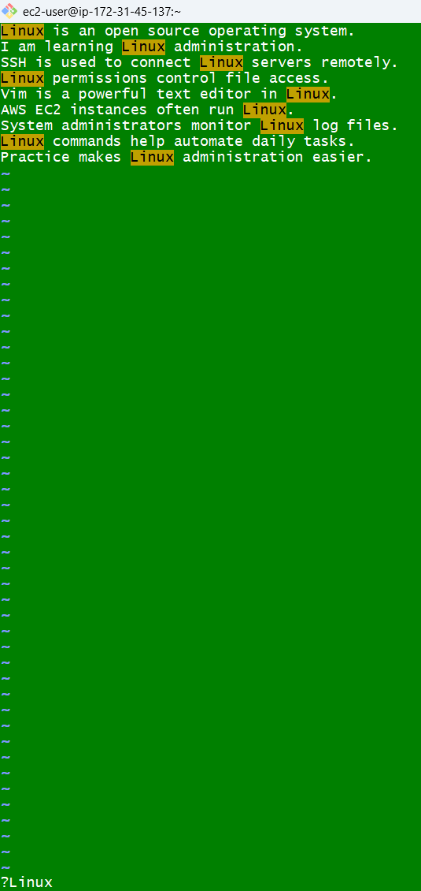 --?Linux
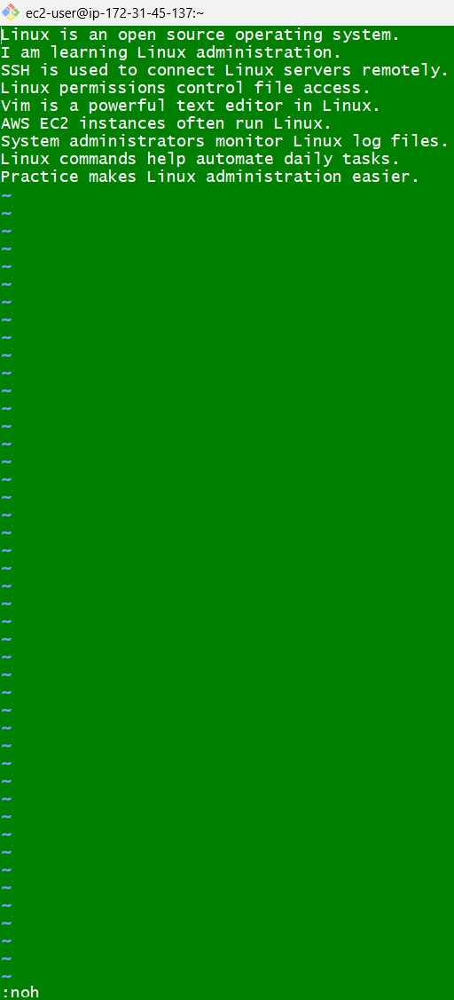 --:noh
-----------------------------------
4. Replace every occurrence of one word in the file with another — in one command.
---
Ans:
Command:
:%s/Linux/LINUX/g
-------------------------------------
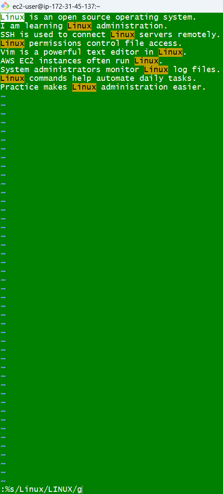 --before press enter
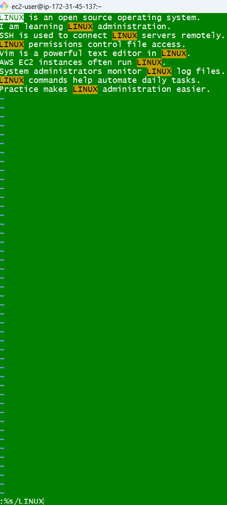 --after press enter and search 'LINUX'
-------------------------------------
5. Go to the bottom of the file, add 3 lines, then undo the last one. Save.
---
Ans:
Command:
Shift+g (G) --to go bottom of the file
yy --copy the line
3p --past the content in three times
u --undo the all newly inserted lines.
o --It open new line to enter ans ESC then 'o' opened new line to enter ESC etc.(adding line by line like 3 lines(11,12,13))
u -- Now it will remove the last(13th) line and the file is having 12 lines of content.
:wq
--------------------------------------------
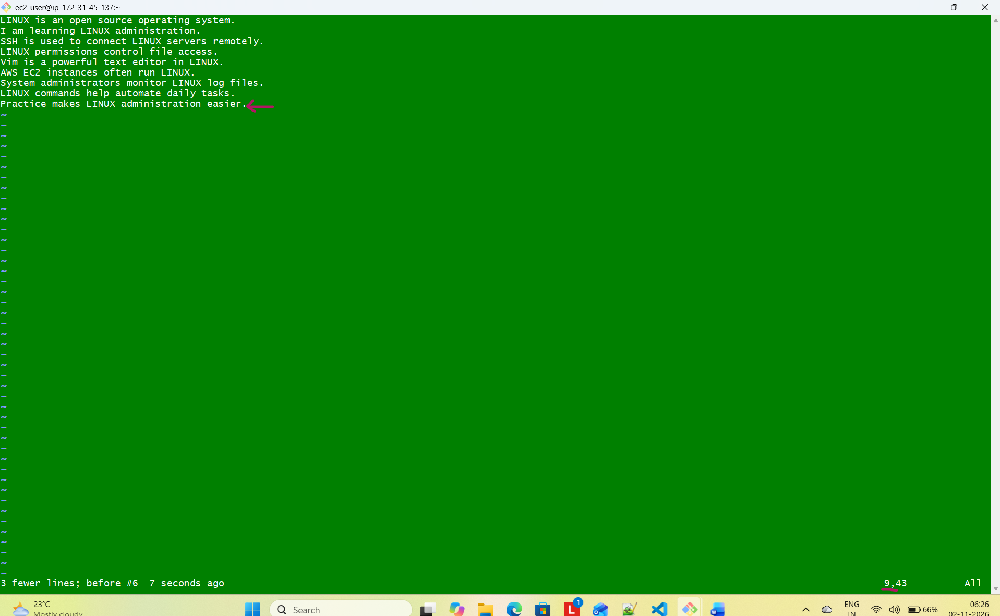
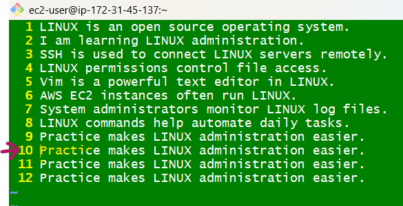
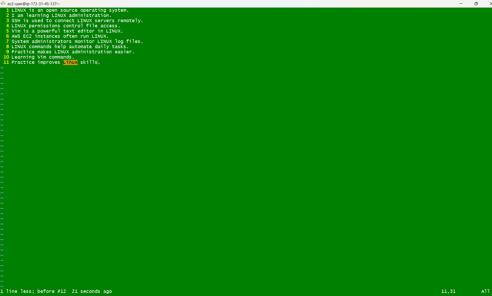
---------------------------------------------
6. Copy one line and paste it 5 times in a single step. What is the command?
---
Ans:
Command:
yy --copy the line
5p --past the content in five times
--------
The file initially contained 9 lines.
I copied the first line using the 'yy' command. Then I moved to the bottom of the file using 'Shift + G' and executed '5p'.
This pasted the copied line 5 times below the current line. As a result, the file now contains 14 lines.
------------------------------------------
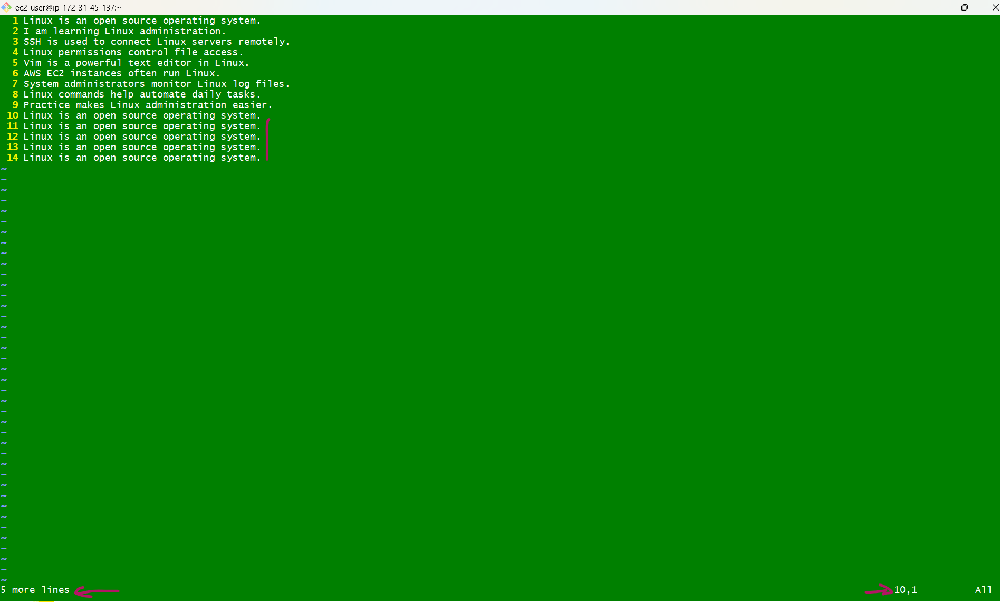
=======================================================================================================================================
---
## Assignment — Linux User Management

1. Create a user `alice`. What primary group was automatically created for her?
---
Ans: A primary group named 'alice' was automatically created and assigned to the user.
Commands:
sudo useradd alice --creation
id alice ---verification
--------
When a new user is created using useradd, Linux automatically creates a primary group with the same name as the user unless specified otherwise.
-------------------------------------------
[ec2-user@ip-172-31-45-137 ~]$ sudo useradd alice
[ec2-user@ip-172-31-45-137 ~]$ id alice
uid=1001(alice) gid=1001(alice) groups=1001(alice)
[ec2-user@ip-172-31-45-137 ~]$
------------------------------------------

2. Set a password for `alice`. Configure the server to allow password-based SSH and connect as `alice`.
---
Ans: 
I set a password for the user alice and enabled password-based authentication in the SSH configuration. After restarting the sshd service, I connected to the server using Alice's credentials. Running whoami confirmed that I was successfully logged in as alice. This activity helped me understand how SSH password authentication works and how Linux validates user credentials during login.

Command:
sudo passwd alice
sudo vi /etc/ssh/sshd_config
Updated the 'PasswordAuthentication' to 'yes' from 'no'.
sudo grep PasswordAuthentication /etc/ssh/sshd_config
sudo systemctl restart sshd   --->restarted the 'sshd' service.
ssh alice@ssh alice@18.61.86.43
whoami
------------------------------
[ec2-user@ip-172-31-45-137 ~]$ sudo passwd alice
Changing password for user alice.
New password:
BAD PASSWORD: The password contains the user name in some form  -->Ignore this message.
Retype new password:
passwd: all authentication tokens updated successfully.
[ec2-user@ip-172-31-45-137 ~]$
-----
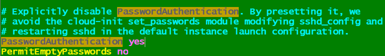
[ec2-user@ip-172-31-45-137 ~]$ sudo grep PasswordAuthentication /etc/ssh/sshd_config
# Explicitly disable PasswordAuthentication. By presetting it, we
PasswordAuthentication yes
---
[ec2-user@ip-172-31-45-137 ~]$ sudo systemctl restart sshd
[ec2-user@ip-172-31-45-137 ~]$
---
lovel@VENISHAMUMMY UCRT64 ~
$ ssh alice@18.61.86.43
** WARNING: connection is not using a post-quantum key exchange algorithm.
** This session may be vulnerable to "store now, decrypt later" attacks.
** The server may need to be upgraded. See https://openssh.com/pq.html
alice@18.61.86.43's password:
   ,     #_
   ~\_  ####_        Amazon Linux 2023
  ~~  \_#####\
  ~~     \###|
  ~~       \#/ ___   https://aws.amazon.com/linux/amazon-linux-2023
   ~~       V~' '->
    ~~~         /
      ~~._.   _/
         _/ _/
       _/m/'
[alice@ip-172-31-45-137 ~]$ whoami
alice
[alice@ip-172-31-45-137 ~]$
------------------
3. Create a group `devops-team`. Add `alice` as a secondary member. Verify.
---
Ans:

I created a new group called devops-team and added alice as a secondary group member using usermod -aG. After verification with the id command, I could see both the primary group alice and the secondary group devops-team. This demonstrated how a user can belong to multiple groups and inherit permissions from additional groups.

Command:
sudo groupadd devops-team
sudo usermod -aG devops-team alice
id alice
-------------------------
[ec2-user@ip-172-31-45-137 ~]$ sudo groupadd devops-team
[ec2-user@ip-172-31-45-137 ~]$ sudo usermod -aG devops-team alice
[ec2-user@ip-172-31-45-137 ~]$ id alice
uid=1001(alice) gid=1001(alice) groups=1001(alice),1002(devops-team)
[ec2-user@ip-172-31-45-137 ~]$
-------------------------

4. Create a user `bob`. Add both `alice` and `bob` to `devops-team`.
---
Ans:

I created another user named bob and added both alice and bob to the devops-team group. Using getent group devops-team, I verified that both users were listed as group members. 
This confirms that multiple users can share a common group for collaborative access and permission management.

Command:
sudo useradd bob
sudo useradd alice
sudo usermod -aG devops-team bob
sudo usermod -aG devops-team alice
getent group devops-team
----------------------------
[ec2-user@ip-172-31-45-137 ~]$ sudo useradd bob
[ec2-user@ip-172-31-45-137 ~]$ id bob
uid=1002(bob) gid=1003(bob) groups=1003(bob)
[ec2-user@ip-172-31-45-137 ~]$ sudo useradd alice
[ec2-user@ip-172-31-45-137 ~]$ id alice
uid=1001(alice) gid=1001(alice) groups=1001(alice)
---
[ec2-user@ip-172-31-45-137 ~]$ sudo usermod -aG devops-team bob
[ec2-user@ip-172-31-45-137 ~]$ sudo usermod -aG devops-team alice
---
[ec2-user@ip-172-31-45-137 ~]$ id bob
uid=1002(bob) gid=1003(bob) groups=1003(bob),1002(devops-team)
[ec2-user@ip-172-31-45-137 ~]$
[ec2-user@ip-172-31-45-137 ~]$ id alice
uid=1001(alice) gid=1001(alice) groups=1001(alice),1002(devops-team)
---
[ec2-user@ip-172-31-45-137 ~]$ getent group devops-team
devops-team:x:1002:alice,bob
----------------------------  

5. Give `alice` sudo access. Verify she can run commands as root.
---
Ans:

I granted administrative privileges to alice by adding her to the wheel group. After switching to the user account, I executed sudo whoami and received root as the output. 
This verified that Alice was able to execute commands with elevated privileges using sudo.

Command:
sudo usermod -aG wheel alice
su - alice
sudo whoami
sudo useradd john
----------------------------------
[ec2-user@ip-172-31-45-137 ~]$ sudo usermod -aG wheel alice
[ec2-user@ip-172-31-45-137 ~]$ su - alice
Password:
Last login: Mon Nov  2 04:45:38 UTC 2026 on pts/1
[alice@ip-172-31-45-137 ~]$
---
[alice@ip-172-31-45-137 ~]$ sudo useradd john
[sudo] password for alice:
[alice@ip-172-31-45-137 ~]$ id john
uid=1003(john) gid=1004(john) groups=1004(john)
[alice@ip-172-31-45-137 ~]$
---------------------------------

6. Remove `alice`'s sudo access. Confirm she can no longer run sudo commands.
---
Ans:

I removed Alice from the wheel group which revoked her sudo privileges. When I attempted to run a sudo command after logging in as Alice, the system denied access and displayed a sudoers permission error. This confirmed that administrative access was successfully removed.

Commands:
sudo gpasswd -d alice wheel
su - alice
sudo whoami
---------------------------------
[ec2-user@ip-172-31-45-137 ~]$ sudo gpasswd -d alice wheel
Removing user alice from group wheel
[ec2-user@ip-172-31-45-137 ~]$ su - alice
Password:
Last login: Mon Nov  2 04:46:09 UTC 2026 on pts/0
[alice@ip-172-31-45-137 ~]$ sudo whoami
[sudo] password for alice:
alice is not in the sudoers file.
[alice@ip-172-31-45-137 ~]$
----------------------------------

7. Add a rule to `/etc/sudoers` that allows only `devops-team` to run `useradd` and `usermod` — nothing else.
Ans:

Added a sudo rule for devops-team group using visudo.
Members of devops-team are allowed to execute only useradd and usermod commands through sudo access.
Verified that sudo useradd and sudo usermod commands are working successfully.

Other administrative commands such as 'sudo cat /etc/passwd' are denied. This follows the principle of least privilege by providing only the permissions required for user management activities.

Command:
sudo vi /etc/sudoers.d/alice
sudo cat /etc/sudoers.d/alice
sudo visudo -c
su - alice
sudo useradd testuser
sudo usermod -aG devops-team testuser
sudo cat /etc/passwd
-----------------------------------
[ec2-user@ip-172-31-45-137 ~]$ id alice
uid=1001(alice) gid=1001(alice) groups=1001(alice),1002(devops-team)
---
[ec2-user@ip-172-31-45-137 ~]$ sudo vi /etc/sudoers.d/alice
[ec2-user@ip-172-31-45-137 ~]$ sudo cat /etc/sudoers.d/alice
%devops-team ALL=(ALL) NOPASSWD: /usr/sbin/useradd, /usr/sbin/usermod

[ec2-user@ip-172-31-45-137 ~]$ sudo visudo -c
/etc/sudoers: parsed OK
/etc/sudoers.d/90-cloud-init-users: parsed OK
/etc/sudoers.d/alice: bad permissions, should be mode 0440

[ec2-user@ip-172-31-45-137 ~]$ su - alice
Password:
Last login: Mon Nov  2 04:56:53 UTC 2026 on pts/0
---
[alice@ip-172-31-45-137 ~]$ sudo useradd testuser
[alice@ip-172-31-45-137 ~]$ sudo usermod -aG devops-team testuser
[alice@ip-172-31-45-137 ~]$ id testuser
uid=1004(testuser) gid=1005(testuser) groups=1005(testuser),1002(devops-team)
[alice@ip-172-31-45-137 ~]$
-------
[alice@ip-172-31-45-137 ~]$ sudo cat /etc/passwd
[sudo] password for alice:
Sorry, user alice is not allowed to execute '/usr/bin/cat /etc/passwd' as root on ip-172-31-45-137.ap-south-2.compute.internal.
[alice@ip-172-31-45-137 ~]$
====================================================================================================================================
---

# Assignment — File Permissions and Ownership

1. Create `secret.txt` with some content. Who can read it by default?
---
Ans: 

Created secrets.txt file and added some content.  The default permission is rw-r--r-- (644)
Owner can read and write the file. Group and others can only read the file.

Command:
cat > secrets.txt
ls -l secrets.txt
----------------------------------
 [ec2-user@ip-172-31-45-137 ~]$ cat > secrets.txt << EOF
> This is my scretes file and it's having my credentials.
> EOF
[ec2-user@ip-172-31-45-137 ~]$ ls -l secrets.txt
-rw-r--r--. 1 ec2-user ec2-user 56 Nov  2 06:05 secrets.txt
[ec2-user@ip-172-31-45-137 ~]$
----------------------------------

2. Restrict it so only the owner can read and write. Switch to another user and try to read it — what happens?
---
Ans:
Changed the permission to 600 using chmod command. Only the owner has read and write access now.
When another user tried to access the file, Linux denied access because the user does not have the required permission.

Command:
chmod go-r secrets.txt
ls -l secrets.txt
cat /home/ec2-user/secret.txt
-------------------------------
[ec2-user@ip-172-31-45-137 ~]$ chmod go-r secrets.txt
[ec2-user@ip-172-31-45-137 ~]$ ls -l secrets.txt
-rw-------. 1 ec2-user ec2-user 56 Nov  2 06:05 secrets.txt
[ec2-user@ip-172-31-45-137 ~]$su - alice
[alice@ip-172-31-45-137 ~]$ cat /home/ec2-user/secret.txt
cat: /home/ec2-user/secret.txt: Permission denied
[alice@ip-172-31-45-137 ~]$
-------------------------------

3. Create `deploy.sh` with one line of content. Make it executable by the owner only. What numeric value represents owner read+write+execute?
---
Ans: 

Numeric value = 7
7 = read(4) + write(2) + execute(1)
---
Created deploy.sh script file and granted executable permission. Permission 700 gives read, write and execute access only to the owner and denies access to everyone else.

Command:
cat > deploy.sh
ls -l deploy.sh
chmod u+x,go-r deploy.sh
ls -l deploy.sh

----------------------------------------
[ec2-user@ip-172-31-45-137 ~]$ cat > deploy.sh
echo "Hello Gopi Krishna"^C
[ec2-user@ip-172-31-45-137 ~]$ ls -l deploy.sh
-rw-r--r--. 1 ec2-user ec2-user 25 Nov  2 06:18 deploy.sh
[ec2-user@ip-172-31-45-137 ~]$ chmod u+x,go-r deploy.sh
[ec2-user@ip-172-31-45-137 ~]$ ls -l deploy.sh
-rwx------. 1 ec2-user ec2-user 25 Nov  2 06:18 deploy.sh
[ec2-user@ip-172-31-45-137 ~]$
----------------------------------------

4. Create `shared/`. Owner has full access, group can read and execute, others have none — set this in numeric form.
---
Ans: 750
Owner  = 7 (rwx)
Group  = 5 (r-x)
Others = 0 (---)
----
Created shared directory and assigned permission 750. Owner has full control of the directory.
Group members can view and enter the directory. Others are completely restricted.

Command:
------------------------------------------
[ec2-user@ip-172-31-45-137 ~]$ mkdir shared/
[ec2-user@ip-172-31-45-137 ~]$ ls -ldr shared
drwxr-xr-x. 2 ec2-user ec2-user 6 Nov  2 06:24 shared
[ec2-user@ip-172-31-45-137 ~]$ chmod 750 shared
[ec2-user@ip-172-31-45-137 ~]$ ls -ldr shared
drwxr-x---. 2 ec2-user ec2-user 6 Nov  2 06:24 shared
[ec2-user@ip-172-31-45-137 ~]$
------------------------------------------

5. Change the owner of `secret.txt` to `alice` and the group to `devops-team`.
---
Ans:

Changed ownership of secrets.txt successfully. Alice became the file owner and devops-team became the associated group.
Linux uses ownership information to control access to files and directories.

Command:
ls -ltr secrets.txt
sudo chown alice:devops-team secrets.txt
ls -ltr secrets.txt
---------------------------
[ec2-user@ip-172-31-45-137 ~]$ ls -ltr secrets.txt
-rw-------. 1 ec2-user ec2-user 56 Nov  2 06:05 secrets.txt
[ec2-user@ip-172-31-45-137 ~]$ chown alice:devops-team secrets.txt
chown: changing ownership of 'secrets.txt': Operation not permitted
[ec2-user@ip-172-31-45-137 ~]$ sudo chown alice:devops-team secrets.txt
[ec2-user@ip-172-31-45-137 ~]$ ls -ltr secrets.txt
-rw-------. 1 alice devops-team 56 Nov  2 06:05 secrets.txt
[ec2-user@ip-172-31-45-137 ~]$
------------------------
6. Create `project/` with 3 files inside. Change ownership of everything in it to `alice:devops-team` in one command.
---
Ans:
Created project directory and added three files. Used chown -R to change ownership recursively.
The ownership was applied to both the directory and all files inside it.

Command:
mkdir project
touch project/file1.txt project/file2.txt project/file3.txt
sudo chown -R alice:devops-team project
ls -l project
-----------------------------------------
[ec2-user@ip-172-31-45-137 ~]$ mkdir project
[ec2-user@ip-172-31-45-137 ~]$ touch project/file1.txt project/file2.txt project/file3.txt
[ec2-user@ip-172-31-45-137 ~]$ sudo chown -R alice:devops-team project
[ec2-user@ip-172-31-45-137 ~]$ ls -l project
total 0
-rw-r--r--. 1 alice devops-team 0 Nov  2 06:33 file1.txt
-rw-r--r--. 1 alice devops-team 0 Nov  2 06:33 file2.txt
-rw-r--r--. 1 alice devops-team 0 Nov  2 06:33 file3.txt
[ec2-user@ip-172-31-45-137 ~]$
------------------------------------------
7. Check the permissions on `/etc/shadow`. Why is it set that way?
---
Ans:
The /etc/shadow file contains encrypted password hashes for all Linux users. 
Only root is allowed to access this file because it contains sensitive authentication information.
Restricting access helps protect user accounts and system security.

Commnad:
ls -l /etc/shadow
ls -ltr /etc/shadow
ls -ldr /etc/shadow
------------------------------------
[ec2-user@ip-172-31-45-137 ~]$ ls -ldr /etc/shadow
----------. 1 root root 970 Nov  2 05:55 /etc/shadow
[ec2-user@ip-172-31-45-137 ~]$ ls -ltr /etc/shadow
----------. 1 root root 970 Nov  2 05:55 /etc/shadow
[ec2-user@ip-172-31-45-137 ~]$ ls -l /etc/shadow
----------. 1 root root 970 Nov  2 05:55 /etc/shadow
[ec2-user@ip-172-31-45-137 ~]$
========================================================================================================================================
---
## Assignment — Key-Based SSH for a New User

1. Create a user `deploy` with no password.
---
Ans:

Command:
----------------------------
[ec2-user@ip-172-31-45-137 ~]$ sudo useradd deploy
[ec2-user@ip-172-31-45-137 ~]$ id deploy
uid=1005(deploy) gid=1006(deploy) groups=1006(deploy)
[ec2-user@ip-172-31-45-137 ~]$
----------------------------
2. Generate a new SSH key pair for this user on your local machine.
---
Ans: 
Generated a new SSH key pair successfully.
deploy      --> private key
deploy.pub  --> public key
Private key will remain in my local machine.
Public key will be copied to the Linux server for authentication.

Command:
ssh-keygen -f deploy
--------------------------------
[ec2-user@ip-172-31-45-137 ~]$ ssh-keygen -f deploy
Generating public/private rsa key pair.
Enter passphrase for "deploy" (empty for no passphrase):
Enter same passphrase again:
Your identification has been saved in deploy
Your public key has been saved in deploy.pub
The key fingerprint is:
SHA256:6ErlUC102yo5Vqz8xlgToYc50vak8wmLn2qmfSlAcWM ec2-user@ip-172-31-45-137.ap-south-2.compute.internal
The key's randomart image is:
+---[RSA 3072]----+
|      . o        |
|  . Eo B +       |
|   +..X O .      |
|  .  = % o       |
| .  . & S        |
|  .  B % o       |
|   .o =.*        |
|   o+ooo         |
|  .+++o          |
+----[SHA256]-----+
[ec2-user@ip-172-31-45-137 ~]$ ll
total 32
-rw-------. 1 ec2-user ec2-user    2655 Nov  2 06:48 deploy
-rw-r--r--. 1 ec2-user ec2-user     607 Nov  2 06:48 deploy.pub
-------------------------------
3. Set up `.ssh/` and `authorized_keys` on the server for `deploy` with the correct permissions and ownership.
---
Ans:

Created .ssh directory and authorized_keys file for deploy user. Configured recommended SSH permissions and ownership.
SSH will reject authentication if the permissions are too open.

Command:
sudo mkdir -p /home/deploy/.ssh
cat deploy.pub  ----------->>>from deploy user local machine
sudo vim /home/deploy/.ssh/authorized_keys
sudo cat /home/deploy/.ssh/authorized_keys
sudo chmod 700 /home/deploy/.ssh/
sudo chmod 600 /home/deploy/.ssh/authorized_keys
sudo chown -R deploy:deploy /home/deploy/.ssh
ls -ld /home/deploy/.ssh/
ls -l /home/deploy/.ssh/
--------------------------------
[ec2-user@ip-172-31-45-137 ~]$ sudo mkdir -p /home/deploy/.ssh
lovel@VENISHAMUMMY UCRT64 /d/DEVOPS/DAWS-92s/repos/linux_shell_assignments (main)
$ cat deploy.pub
ssh-ed25519 AAAAC3NzaC1lZDI1NTE5AAAAIAZDDcFPAEa8/Zi7Wlo91MnIUaiSPC1A+Iugi16rkd2g lovel@VENISHAMUMMY
---
[ec2-user@ip-172-31-45-137 ~]$ sudo vim /home/deploy/.ssh/authorized_keys
[ec2-user@ip-172-31-45-137 ~]$ sudo cat /home/deploy/.ssh/authorized_keys
ssh-rsa AAAAB3NzaC1yc2EAAAADAQABAAABgQC3vI7EO6s2Mme9mwJPG6Oxi1da+yy/AJ4v9IISunKzSXaKZ+MV06t2Uk8UqKjM7TVnAQbKV2wPz0lSmxpMaSwCQ6mPglzB7LK/N7i9IpxEWWQX2WaN9zyvnVVviv2ZiT7c2Up9m64NonfgHgpg1r0P08YFfx0I+do2dwvvZN7rTLny4QO+nQ6kNSeRklImAidgdHjfb1ej8UEb3XVetgO2vPT9mOPAVeRNVMXPFuTSI8Msfs9MeA3Fmh0vGpeurM80ReHnFWUP0Dea3FQ47hlrKWUFT7vN3bOx9+nCNlE89yKgwl/5vR3nyRh3ZyvbEug5hXJtq1uI/ftGwwN6U+daYk8xsNxvEjAkViQzWhd4BVqsbzg0Oo5u+bUhQL+zs7Q4F7WGwhrxEBpTzSnZCsSlNKHRx9xoKcHfBJrzLT1GUoeuCkkS+tm3MNb+R93dSt/4aLx6gN5NkTWxFJLni0AHG2LJqBT5/7ckYNUrc5//ICIsCMA4K+o4pg5vzx05eiE= ec2-user@ip-172-31-45-137.ap-south-2.compute.internal
---
[ec2-user@ip-172-31-45-137 ~]$ sudo chmod 700 /home/deploy/.ssh/
[ec2-user@ip-172-31-45-137 ~]$ sudo chmod 600 /home/deploy/.ssh/authorized_keys
[ec2-user@ip-172-31-45-137 ~]$ sudo ls -l /home/deploy/.ssh/
total 4
-rw-------. 1 root root 607 Nov  2 07:03 authorized_keys
---
[ec2-user@ip-172-31-45-137 ~]$ sudo chown -R deploy:deploy /home/deploy/.ssh
[ec2-user@ip-172-31-45-137 ~]$ sudo ls -ld /home/deploy/.ssh/
drwx------. 2 deploy deploy 29 Nov  2 07:03 /home/deploy/.ssh/
[ec2-user@ip-172-31-45-137 ~]$ sudo ls -l /home/deploy/.ssh/
total 4
-rw-------. 1 deploy deploy 607 Nov  2 07:03 authorized_keys
[ec2-user@ip-172-31-45-137 ~]$
-----------------------------------

4. Connect to the server as `deploy` using the private key.
---
Ans:
Successfully connected to the Linux server using key-based authentication.
The SSH server validated the public key stored in authorized_keys and allowed access without asking for a password.
Command:
ssh -i deploy deploy@18.61.86.43
whoami
pwd
----------------------------
lovel@VENISHAMUMMY UCRT64 /d/DEVOPS/DAWS-92s/repos/linux_shell_assignments (main)
$ ssh -i deploy deploy@18.61.86.43
** WARNING: connection is not using a post-quantum key exchange algorithm.
** This session may be vulnerable to "store now, decrypt later" attacks.
** The server may need to be upgraded. See https://openssh.com/pq.html
   ,     #_
   ~\_  ####_        Amazon Linux 2023
  ~~  \_#####\
  ~~     \###|
  ~~       \#/ ___   https://aws.amazon.com/linux/amazon-linux-2023
   ~~       V~' '->
    ~~~         /
      ~~._.   _/
         _/ _/
       _/m/'
[deploy@ip-172-31-45-137 ~]$ whoami
deploy
[deploy@ip-172-31-45-137 ~]$ pwd
/home/deploy
[deploy@ip-172-31-45-137 ~]$
---------------------------
5. Try connecting without specifying the key. What happens and why?
---
Ans:
Connection failed because a valid private key was not supplied during authentication.
The server only trusts the public key configured in the deploy user account.
Without the matching private key, SSH login is rejected.

Command:
ssh deploy@18.61.86.43
---------------------------------
lovel@VENISHAMUMMY UCRT64 ~
$ ssh deploy@18.61.86.43
** WARNING: connection is not using a post-quantum key exchange algorithm.
** This session may be vulnerable to "store now, decrypt later" attacks.
** The server may need to be upgraded. See https://openssh.com/pq.html
deploy@18.61.86.43's password:
Permission denied, please try again.
deploy@18.61.86.43's password:
--------------------------------------
6. Disable password authentication on the server. Verify that a password login is rejected. Why does this matter for production?
---
Ans:

Disabled password authentication and allowed only key-based authentication.This is considered a security best practice in production environments because SSH keys are much harder to guess or brute-force than passwords.
By disabling password login, the risk of unauthorized access through weak passwords is significantly reduced.

Command:
sudo vi /etc/ssh/sshd_config
sudo systemctl restart sshd
sudo grep PasswordAuthentication /etc/ssh/sshd_config
ssh deploy@18.61.86.43
---------------------------------------
[ec2-user@ip-172-31-45-137 ~]$ sudo vi /etc/ssh/sshd_config
[ec2-user@ip-172-31-45-137 ~]$ sudo systemctl restart sshd
[ec2-user@ip-172-31-45-137 ~]$ sudo grep PasswordAuthentication /etc/ssh/sshd_config
# Explicitly disable PasswordAuthentication. By presetting it, we
PasswordAuthentication no
# PasswordAuthentication.  Depending on your PAM configuration,
# PAM authentication, then enable this but set PasswordAuthentication
[ec2-user@ip-172-31-45-137 ~]$
---
lovel@VENISHAMUMMY UCRT64 ~
$ ssh deploy@18.61.86.43
** WARNING: connection is not using a post-quantum key exchange algorithm.
** This session may be vulnerable to "store now, decrypt later" attacks.
** The server may need to be upgraded. See https://openssh.com/pq.html
deploy@18.61.86.43: Permission denied (publickey,gssapi-keyex,gssapi-with-mic).
lovel@VENISHAMUMMY UCRT64 ~
===================================================================================================================================

> If a command fails, read the error carefully — it usually tells you what is wrong. Search if needed. Bring questions to the Q&A session.